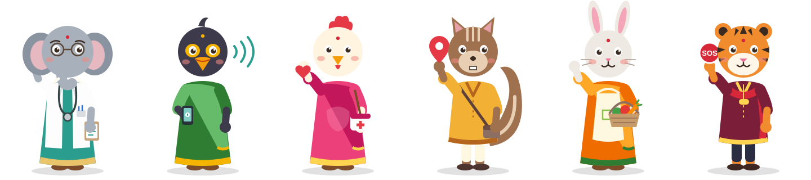
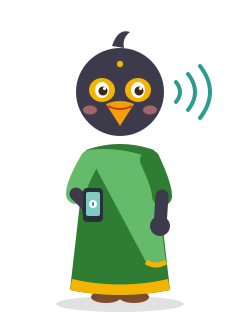
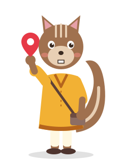
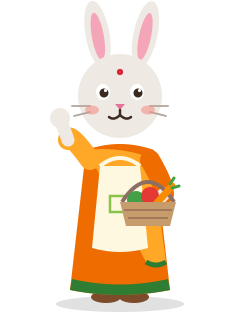
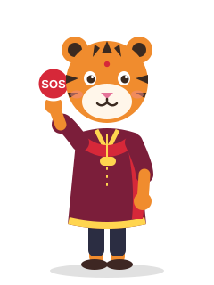

# The Sakhi cast

Sakhi's guides are friendly animals drawn as people: they stand on two legs, wear everyday Indian clothes (saree, kurta, doctor's coat) and each one looks after one feature of the app. A familiar face on every screen makes the app easier to follow for first-time smartphone users and for women who don't read much: "tap Tara" is easier to remember than "open the SOS screen".



| | Character | Animal | Feature | Personality | Catchphrase |
|---|---|---|---|---|---|
|  | **Dr. Ganga** | Elephant | AI symptom checker | Calm and wise, never in a hurry. Remembers everything you tell her. | "Tell me slowly, where does it hurt?" |
|  | **Mira** | Mynah | Voice assistant | Chatty and cheerful. Happy to repeat things as often as needed. | "Just speak, I am listening!" |
|  | **Champa** | Hen | Pregnancy and child care | Warm, motherly and protective, like the village ASHA didi. Wears the ASHA pink saree. | "You and your baby are my little chicks." |
|  | **Chiku** | Palm squirrel | Facility finder | Quick and curious. Knows every lane and shortcut. | "Follow me, the clinic is close by!" |
|  | **Bhoomi** | Rabbit | Nutrition scanner | Practical and encouraging. Loves greens, millets and dal. | "Show me your thali!" |
|  | **Tara** | Tigress | SOS and safety | Brave, steady and fast. Speaks in short, clear sentences in an emergency. | "Do not worry, help is on the way." |

## Why these animals

- **Elephant → doctor.** Elephants stand for memory and wisdom across India, a good fit for the character who asks questions and remembers your history.
- **Mynah → voice.** Mynahs are known for talking, so the bird is the one who listens and speaks back.
- **Hen → mother care.** A mother hen keeping her chicks close.
- **Palm squirrel → finding places.** A common sight in every village, always darting along paths.
- **Rabbit → food.** A gentle vegetable lover.
- **Tigress → SOS.** India's national animal, strong and protective when it matters.

## Design rules

- Every character shares one body template (`tools/generate_characters.py`), so they stay the same height and style. Only the head, colours, outfit and prop change.
- Each character has a **signature colour** (see `colorValue` in `lib/characters/sakhi_character.dart`). Use it for that feature's app bar, buttons and tile.
- Props tell you the feature without words: stethoscope and clipboard, phone with sound waves, first-aid bag, map pin, vegetable basket, SOS button.
- Simple flat shapes and no gradients, so the SVGs stay small and render fast on low-end Android phones.
- **Tara's screen is about getting help, not about the mascot.** On the SOS screen keep her small and the action button big.

## Using them in the app

```dart
import 'package:flutter_svg/flutter_svg.dart';
import 'characters/sakhi_character.dart';

final guide = SakhiCast.forFeature(SakhiFeature.pregnancyCare);
SvgPicture.asset(guide.assetPath, height: 160);
Text(guide.greeting(Localizations.localeOf(context).languageCode));
```

Add the asset folder to `pubspec.yaml`:

```yaml
flutter:
  assets:
    - assets/characters/
```

Greetings are included in English, Hindi and Kannada. Add the app's other languages through the usual translation review.

## Changing the artwork

Edit `tools/generate_characters.py` and run:

```sh
python3 tools/generate_characters.py
```

This rewrites the six character SVGs and `lineup.svg` in `assets/characters/`.
